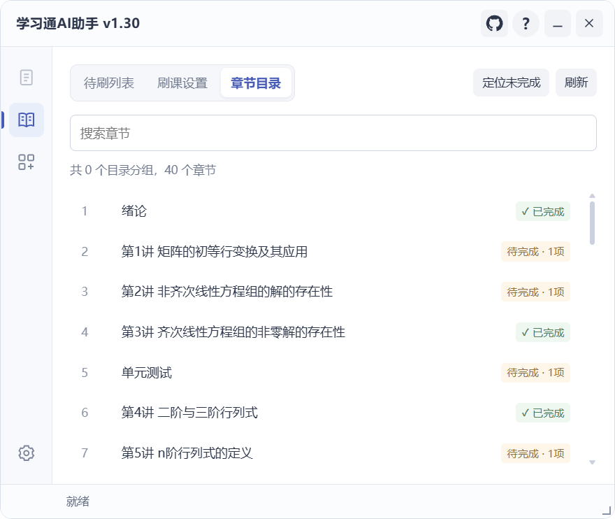
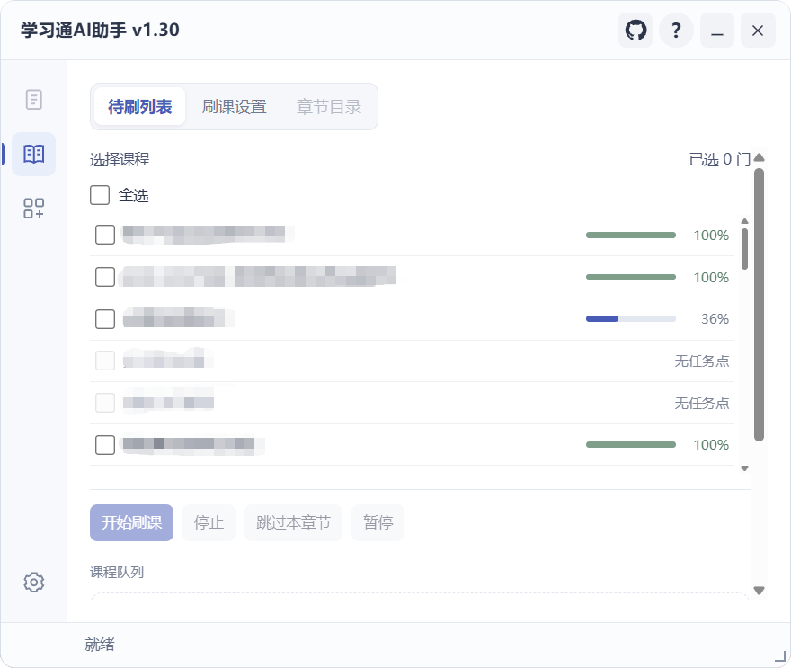
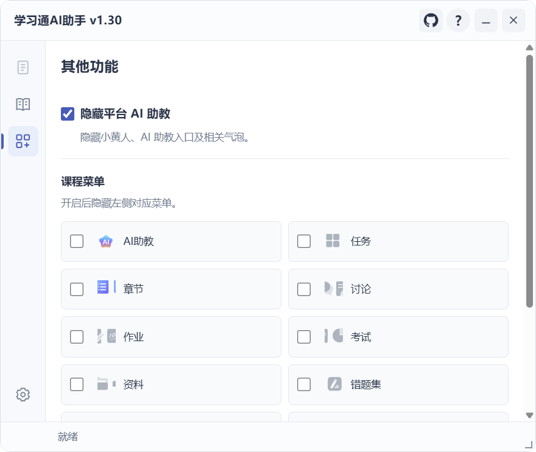

# 核心功能

学习通AI助手 是配合 Tampermonkey 使用的学习通网页辅助脚本。它将题目、课程和模型设置集中到同一个面板，继续通过学习通原生页面完成操作。

## 题目识别与 AI 分析

- 提取章节测验与作业中的题目、选项、题干图片及共享材料。
- 逐题展示答案、解析与处理状态，支持未完成筛选、题号定位、单题复制和原图查看。
- 支持图片材料分析；具体能力取决于所选模型及接口。
- 保留成功结果，提供失败题恢复、未完成重试和可选结果暂存。

[阅读题目与答案指南](guide/questions.md)

## 原生答案预填

将符合条件的答案写入已关联的原生作答控件。已有不同作答、控件对应不明确或题型未适配时，保留原有内容并反馈原因。

手动作业流程中，核对答案后由你保存或提交。章节自动提交使用本次运行的明确授权，详见[单课程学习](guide/study.md#自动提交章节测验)。

## 课程与章节学习

- 处理视频播放、支持的资料阅读和章节测验，按设置跳过已确认完成的任务。
- 可从课程首页进入原生学习页，并交接启动状态；实际任务处理复用同一套执行器。
- 提供待刷滚轮、暂停／继续、跳过章节、停止及待办报告。
- 目录显示完成、未完成、无任务点、待解锁及入口未确认等状态；未确认内容留待核对。

## 跨课程队列

从个人空间课程列表勾选本次课程，按照原列表顺序逐门处理。单门课程的可处理任务结束后，返回课程列表进入下一门。

从课程首页、章节目录或实际学习页独立开始时，运行范围限于本课程。

[阅读课程队列指南](guide/course-queue.md)

## 模型与界面工具

支持 DeepSeek、OpenAI、通义千问、Kimi、智谱 GLM 和自定义 OpenAI 兼容接口。提供模型列表获取、连接检测和图片能力检测；检测操作会使用服务商额度。

此外还包括学习休息、固定／随机视频间隔、倍速选项、平台 AI 助教隐藏、课程菜单管理、个人空间默认打开课程，以及窗口拖动、缩放和悬浮窗。

## 程序预览

| 待刷列表 | 章节目录 |
| --- | --- |
|  |  |
| **题目与答案** | **课程选择** |
|  |  |
| **工具设置** | **其他功能** |
|  |  |

### 页面入口

