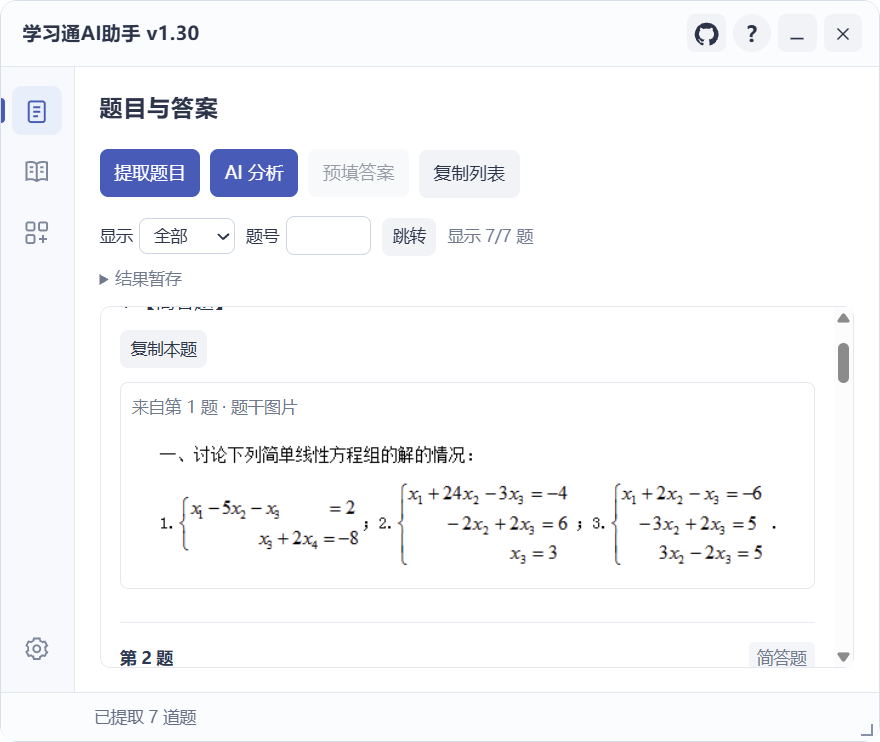

# 题目与答案

适用于脚本已识别的章节测验和作业页面。不同学校的页面及题型可能存在差异，助手会显示可操作状态。

## 基本流程

1. 打开测验或作业，进入“学习通AI助手 → 题目与答案”。
2. 点击“提取题目”，查看题干、选项、图片和共享材料的对应关系。
3. 点击“AI 分析”或页面上的“一键生成答案”，等待逐题结果。
4. 核对答案和解析，再使用“预填答案”。作业请在原页面核对后保存或提交。

*题目列表保留原始图片，便于核对识别内容。*

## 列表操作

| 操作 | 用途 |
| --- | --- |
| 未完成筛选 | 集中查看尚待处理的题目 |
| 题号定位 | 快速跳到指定题号 |
| 单题复制 | 复制当前题目及对应内容 |
| 原图查看 | 放大检查题干图片与材料 |
| 未完成重试 | 保留成功结果，继续处理失败或未完成部分 |
| 结果暂存 | 按需保存和读取近期结果，恢复后重新校验预填资格 |

## 图片题怎么配置

先在[模型设置](models.md)中选择支持图片输入的模型。题干图片与共享材料会按关联关系处理；若材料读取失败，请使用相应重试操作，或在原页面检查图片是否加载。

模型的视觉、思考和检索能力以服务商接口、模型配置及检测结果为准。

## 已有答案会怎样处理

已有不同答案时，助手保留原有作答。遇到选项关系不明确、控件对应不可靠、富文本同步未确认或题型未适配时，会提示需人工处理。

## 核对与提交

AI 输出用于辅助，请对照题目检查。手动作业流程由你在原页面保存或提交；自动学习中的章节测验另按本次[自动提交授权](study.md#自动提交章节测验)处理。
