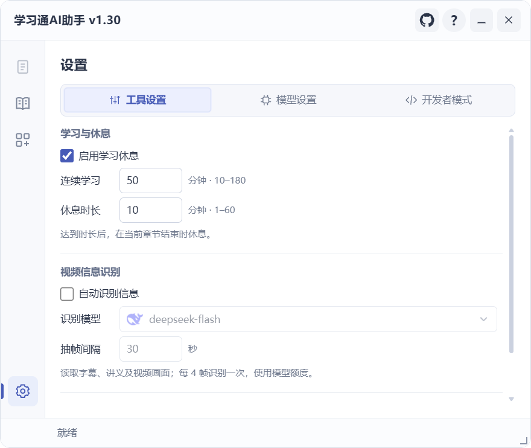
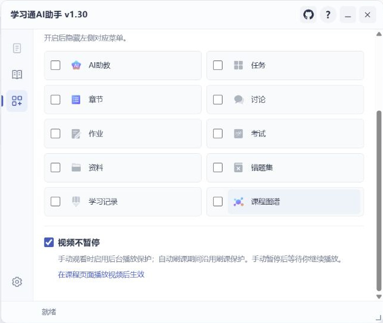

# 工具与界面

## 工具设置

**学习休息**：开启后按连续学习时长安排休息，在当前章节结束时执行。课程队列继续沿用本轮学习时长。

**视频信息识别**：按需读取可用字幕、讲义及视频画面。可选择模型和抽帧间隔；此功能会使用模型额度。

*工具设置与模型连接、运行诊断分开显示。*

## 其他功能

| 开关或工具 | 作用 |
| --- | --- |
| 隐藏平台 AI 助教 | 隐藏已适配的 AI 助教入口及相关气泡 |
| 视频不暂停 | 手动观看时启用播放保护，手动暂停后等待你继续播放 |
| 课程菜单 | 在具体课程中读取原生菜单，逐项隐藏或恢复；点击图标或名称打开原生菜单 |
| 默认打开课程 | 在个人空间开启后，下次访问时自动打开原生“课程”栏目 |

课程菜单管理仅在进入具体课程后提供，个人空间侧栏保留原样。任务运行期间，菜单导航按资格禁用。

*菜单项目按当前课程页面动态读取。*

## 窗口操作

拖动标题栏移动窗口；拖动边缘或右下角调整大小。最小化后显示悬浮入口，可再次打开。

“项目介绍”对话框可拖动，打开时保持页面原有亮度。控件不可用时，可查看禁用原因。

## 视频间隔与倍速

视频间隔位于“刷课设置”，支持固定时长和随机区间。倍速使用播放器原生提供、最高且不超过 2 倍的档位；旁边的小问号提供说明。

## 运行诊断

在 **设置 → 开发者模式** 查看详细报告，复制运行摘要或错误报告。课程结束后仍可查看人工待办、失败和待解锁内容。

反馈前请检查并遮挡账号、课程链接参数和凭据，参阅[反馈问题](../about.md#反馈问题)。
