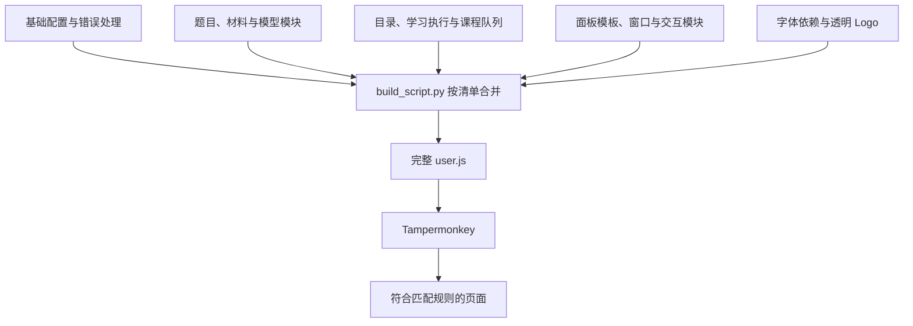
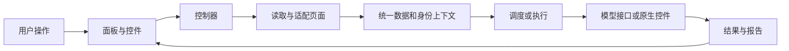

# 启动与内部架构

## 开发时分模块，安装时合并

主脚本采用多个普通 JavaScript 源文件开发。`build_script.py` 按明确顺序读取这些文件，嵌入面板 HTML、Logo 和字体处理依赖，再生成根目录完整的 `学习通AI助手.user.js`。

这些模块最终共享脚本闭包。当前构建方式以文件组织职责，运行时直接调用闭包内函数；浏览器安装一个完整用户脚本即可。



构建还会完成三项工作：

1. **统一版本**：更新脚本元数据、内部版本和面板标题。
2. **检查构建清单**：重复模块、缺失模板标记会中止生成。
3. **嵌入字体依赖**：按清单核对依赖文件 SHA-256，保留上游许可，再拼入脚本。

字体字符映射表通过脚本声明的资源读取，字体解析库随完整脚本提供。

## 为什么要尽早启动

脚本元数据使用 `document-start`。这时可以先安装播放相关的基础保护和通信监听；面板、题目与目录则在 DOM 可以读取后初始化。

初始化的主要顺序是：

```text
字体依赖与基础函数
  → 初始化播放保护
  → 初始化凭据监听和各类跨页通信
  → 等待 DOMContentLoaded，或直接进入页面观察
  → 识别题目页、学习页、课程首页和课程列表
```

不同 iframe 也有自己的文档和脚本生命周期。因此，各适配器会判断当前文档属于顶层面板、章节子页还是阅读器，只在对应位置承担职责。

## 页面变化怎样被发现

学习通经常在同一页面替换 iframe、切换章节或延迟插入题目。`startQuizObserver()` 使用：

- `MutationObserver` 观察节点增删及关键属性变化。
- 捕获阶段的 iframe `load` 事件。
- 页面离开时的 `pagehide` 清理。
- 适配器自己的状态通知与存储变化监听。

刷新请求会合并到约 **40ms** 的延后处理里，避免同一批 DOM 变化连续初始化。观察时会过滤助手自身的节点，Shadow DOM 内部变化也不会沿普通文档观察链触发整页重建。

这相当于把“页面变了很多次”合并成“重新检查一次目前的页面”。

## 四层职责

### 1. 页面适配层

负责识别具体的 DOM、URL、原生控件和平台状态，并产出统一描述。

例如，课程目录可来自课程首页的章节 iframe，也可来自实际学习页；两者都会转成供目录面板使用的条目结构。

### 2. 数据与上下文层

记录题目内容、材料来源、节点归属、课程身份和配置签名。它解决“当前准备操作的对象还是不是刚才那个对象”。

题目快照会保存文档及节点关联；课程执行会保存课程、班级、学习身份和预期章节等信息。

### 3. 执行与调度层

包括逐题分析队列、预填动作计划、章节执行器和外层课程队列。它们各自处理取消、等待、重试和结果归档。

页面导航、模型调用、填写控件、提交测验属于不同动作，分别经过对应检查。

### 4. 显示与交互层

面板显示状态、报告、目录和滚轮。用户点击按钮后，控制器调用执行链；执行链再通过控制器更新界面。



## 面板为何采用 Shadow DOM

主面板把样式放在自己的 Shadow DOM 中，减少平台样式对按钮、输入框和布局的影响。API Key 编辑区域另使用闭合的 Shadow DOM，并在切换服务商、繁忙或离页时清空当前输入。

面板实例与业务任务分别保存。切换“待刷列表／刷课设置／章节目录”主要改变显示状态，原任务及报告继续由对应控制器维护。

## 停止如何传递到各模块

异步任务使用 `AbortController`、当前任务标识和执行代次共同约束：

1. 停止操作撤销当前任务的继续权限。
2. 中止可取消的请求和等待。
3. 后续回调再次检查任务身份。
4. 过期结果不再更新当前界面或执行新动作。
5. 在清理阶段撤销定时器、事件监听和播放保护。

同一取消信号可以传到模型请求、图片读取、章节等待和跨页交接，减少旧任务残留。

## 主要源码位置

| 文件 | 主要职责 |
| --- | --- |
| `build_script.py` | 模块清单、版本同步与完整脚本生成 |
| `sources/assistant-core.js` | 元数据、基础函数、请求与答案协议 |
| `implementation.js` | 页面初始化与观察入口 |
| `sources/assistant-controller.js` | 面板状态和用户操作协调 |
| `sources/assistant-window.js` | 窗口状态、拖动、缩放和悬浮入口 |
| `sources/assistant-navigation.js` | 面板、栏目及设置页切换 |
| `sources/assistant-errors.js` | 统一错误目录与诊断处理 |
