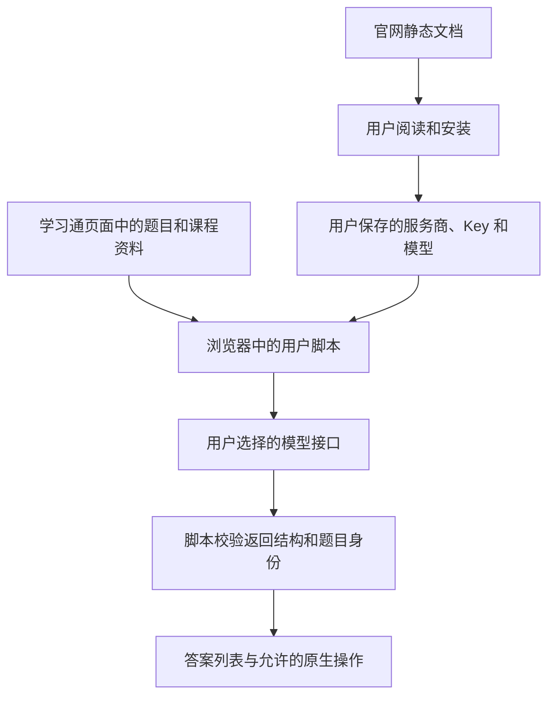
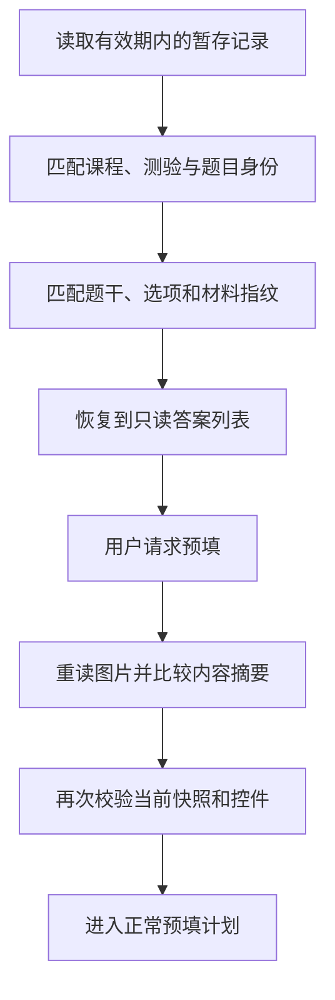

# 模型、数据与保护机制

## 一、模型请求发往哪里

脚本读取当前服务商配置，生成该服务商支持的请求，再由 `GM_xmlhttpRequest` 发送。官网只提供静态文档，模型调用发生在已安装的用户脚本内。



当前预设包括 DeepSeek、OpenAI、通义千问、Kimi、智谱 GLM，另外提供自定义 OpenAI 兼容接口。

### 服务商适配如何工作

统一配置包含服务商、基础地址、Key、模型、图片能力、思考选项和视频识别设置。调用层再处理接口差异：

- 模型列表使用相应的 `models` 地址。
- 答案生成使用相应的 `chat/completions` 地址。
- 已支持的思考、强度和 JSON 参数按能力保留或移除。
- 图片字段按服务商格式调整，例如 OpenAI 图像的 `detail` 设置。
- 接口响应经过统一解析后，才交给逐题答案归一化。

返回模型名表示接口列出了这个型号。图片及其他能力按配置和检测证据另行判断。

### 自定义地址为何需要确认

基础地址必须是有效 HTTPS 地址，且不包含账号密码、查询参数或片段。用户填写 API 前缀，程序再添加具体路径。

保存自定义 Key 时，会同时记录其获得授权的基础地址。基础地址变化后，原凭据需重新确认，才能用于新地址。

## 二、图片能力怎样检测

`createModelImageChallenge()` 在本地生成带随机六位数字的测试图片，将图像交给用户选定的模型，检查返回 JSON 中的数字是否完全相符。

```text
生成随机数字图片
  → 发往选定模型
  → 检查响应结构和六位数字
  → 按服务商、模型、接口指纹保存成功证据
```

检测由用户主动发起，会实际使用接口额度。当前成功记录最多保留 **200** 项；查找范围包含服务商、准确模型 ID 和基础地址指纹。

自定义接口还提供用户声明的图片支持选项。题目请求会结合当前配置判断是否允许发送图片材料。

## 三、课程资料怎样成为模型上下文

自动信息识别开启后，脚本按已适配来源收集：

| 来源 | 读取方式 |
| --- | --- |
| 字幕 | 已加载且可访问的 captions／subtitles 轨道 |
| 课件文字 | 已识别阅读器中的文字层 |
| 课堂笔记 | 由明确适配器传入的笔记区域 |
| 视频画面 | 播放过程中的定时采样及文字识别 |

每项资料包含来源种类、标题、文本及来源 ID，统一放入对应章节的上下文。题目请求只取相应章节的资料集合。

### 上下文如何去重和限量

`mergeCourseContext()` 以来源种类和来源 ID 查找已有项目，更新同源内容。字幕会过滤重复文本；连续画面使用滚动窗口保留后续内容。

当前限制为：

- 最多 24 项材料。
- 单项最多 4000 字符。
- 总文本最多 12000 字符。

超过限制时，会优先腾出较早的视频画面文字，并对剩余资料作有界截取；同时保留 `truncated` 状态。

### 视频画面识别的具体过程

`captureCourseVideoFrame()` 读取当前已显示画面，按宽度上限 1280 像素等比缩放，生成质量参数为 0.8 的 JPEG。采样依据媒体时间的正向进展，跳过未就绪或正在 seeking 的状态。

采样间隔默认 **30 秒**，配置范围 **5–300 秒**。最多四帧组成一次识别请求，剩余画面可在 flush 阶段继续处理。

单个视频最多采样 120 帧，待处理队列最多 12 帧；队列积压时移除较早样本。响应中的帧 ID 必须能对应仍有效的采样记录，之后再把文字合并到章节上下文。

画面读取或识别失败会记录状态，正常播放仍按播放流程继续。此功能开启时保持原速。

## 四、联网检索怎样处理

当前联网检索接入使用 DeepSeek 对应的原生 Web Search 流程。模型名、Key 和开关仍来自本轮配置，具体请求由检索函数构造。

脚本要求响应包含搜索工具结果，并从中提取有效来源、标题和引用摘要。实际答案请求随后携带这些证据。逐题分析中的检索阶段通过单独的串行链安排，避免多个检索环节互相干扰。

检索与后续解答是额外模型调用。提示词把搜索摘要、题目、课程资料和图片说明都作为待分析材料，并要求保留原题 ID。

## 五、哪些数据保存在哪

| 数据 | 保存位置或范围 | 生命周期或约束 |
| --- | --- | --- |
| 服务商 Key 和学习开关 | Tampermonkey 脚本存储 | 按服务商保存，用户可修改或清除 |
| 当前题目节点、控件及快照绑定 | 当前页面内存 | 页面、节点或内容改变后重新检查 |
| 图片准备结果和读取 Promise | 当前任务内存缓存 | 按当前材料身份复用，失效或清理时释放 |
| 字体映射 | 当前页面内存缓存 | 相同字体共享解析结果 |
| 可选答案暂存 | GM 存储 | 默认关闭，最多 3 份，24 小时内有效 |
| 标签页交接身份 | `GM_getTab` / `GM_saveTab` | 归属当前标签页 |
| 首页启动、课程队列和运行报告 | 带身份的 GM 记录 | 按各自期限、状态和令牌检查 |
| 学习页当前会话标识 | `sessionStorage` | 与恢复判断关联 |
| 网站主题偏好 | 浏览器本地存储 | 供官网主题切换使用 |

API Key 通过请求认证头发送给选定服务商。脚本依靠管理器存储、地址授权和当前操作检查管理凭据；题目与资料的处理政策由对应服务商决定。

## 六、结果暂存为什么先只读恢复

答案缓存的匹配由两部分构成：

1. **身份键**：课程、班级、学习身份、测验字段和题目 ID 等信息的 SHA-256。
2. **内容指纹**：题干、选项、材料及其关系等内容的 SHA-256。

每条暂存记录保存答案、必要用量和图像摘要，单条编码后的大小最多 500000 字节。开启暂存后，成功结果通过延后写入合并保存。

恢复流程先创建新的页面快照，匹配身份与内容，再把答案载入只读列表。准备预填时，还要完成全部题目的结果检查、重新读取图像并比较原摘要。



这里的摘要用于识别内容和关联，缓存的答案本身仍是脚本管理器保存的文本结果。

## 七、自动提交授权怎样约束操作 { #自动提交授权怎样约束操作 }

自动提交与普通预填有不同权限。当前实现使用本次真实操作和明确确认建立授权。

- 首页交接把权限放入本次一次性记录；目标页领取时消费。
- 课程队列把授权范围限定在本轮选择的课程，并在相应进入流程检查。
- 取消、过期、身份或配置变化后，相关交接权限失效。
- 学习页导航恢复重建运行对象时，`submit` 按当前实现置为 `false`，后续按恢复规则处理。
- 部分答案、未确认的控件写入、需要人工保存的富文本及未知提交结果，都有独立分支。

开始提交前，代码先保存提交阶段和原测验身份，再点击原生入口。提交结果不明时，报告保留这一事实，并阻止相关自动重试继续提交。

## 八、为什么有多层“运行锁”

| 机制 | 管理范围 |
| --- | --- |
| `starting` 和当前运行对象 | 防止同一执行实例重复开始 |
| 当前文档的运行标记 | 协调该学习页内的运行状态与控件资格 |
| 运行心跳和会话记录 | 检查保存状态是否仍属于当前运行 |
| 浏览器 Web Locks | 在可用时协调同源、同课程的竞争 |
| 首页请求锁 | 串行领取同一个启动请求 |
| 队列 ID、轮次和索引 | 拒绝旧课程回调继续新一门 |

不同机制覆盖不同的生命周期。跨来源的页面继续通过 GM 记录、标签页身份和目标来源核对交接。

## 九、错误如何变成可读报告

错误目录把异常规范化为固定编号，例如：

| 编号 | 对应类别 |
| --- | --- |
| `CX-NET-001` / `CX-NET-002` | 网络失败／请求超时 |
| `CX-CFG-001` | Key 尚未配置 |
| `CX-RES-006` | 返回题目数量或 ID 与请求不匹配 |
| `CX-PAR-008` | 题目快照失效 |
| `CX-CTL-006` | 原生控件被替换 |

安全导出的诊断使用错误目录和限定字段，原始错误原因留在内部处理。请求、任务和运行报告通过各自标识关联，便于区分发生在哪一层。

两类自动暂停需要分别理解：

- **模型请求调度保护**：连续暂时性失败达到阈值，或服务商要求等待过长时暂停后续请求。
- **章节连续超时保护**：由学习开关控制，开启后按章节超时结果计数。

人脸识别、验证码、身份变化和提交不明确等条件通过各自检查处理。

## 主要源码位置

`sources/model-providers.js`、`sources/model-capability.js`、`sources/credential-settings.js`、`sources/course-context.js`、`sources/course-context-collector.js`、`sources/course-video-info.js`、`sources/analysis-history.js`、`sources/assistant-errors.js`。
