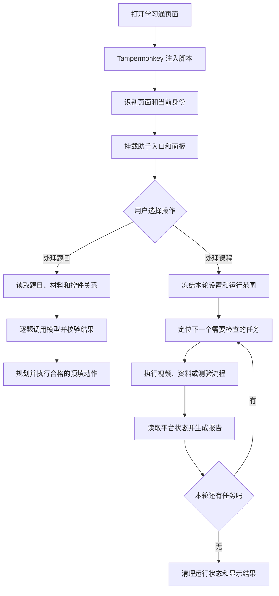

# 原理介绍

学习通AI助手运行在浏览器里：从当前学习通页面读取内容，交给相应模块处理，再通过原生控件执行允许的操作。题目推理由你配置的模型服务完成，页面识别、任务定位、答案校验和队列控制由脚本完成。

本文依据 **2026-10-24 发布的 v1.31 源码**整理。完整脚本见 [v1.31 正式发行版](https://github.com/zhu-hailin/chaoxing-ai-assistant/releases/tag/v1.31)。文中的函数名和参数对应这一版本，图表是对调用关系的归纳。

## 先看整个过程

这张图包含两条执行链：

- **题目链**：页面解析 → 材料准备 → 模型请求 → 答案校验 → 预填。
- **课程链**：范围确定 → 任务定位 → 具体任务处理 → 状态确认 → 后续章节或课程。

课程里的章节测验会调用题目链。课程队列则位于课程链外层，负责决定什么时候进入下一门课程。

## 各个角色负责什么

| 角色 | 负责的事情 | 举例 |
| --- | --- | --- |
| 学习通页面 | 提供课程目录、题目、播放器、阅读器、提交入口及任务状态 | 当前章节有 1 个待完成视频 |
| 脚本适配器 | 把不同页面结构转成统一描述 | 将两种页面的多选题归一成选项键列表 |
| 脚本执行器 | 根据规则、设置和当前状态安排动作 | 播放视频、等待资料状态、预填答案 |
| 模型服务 | 接收文字或图片并返回答案、解析、画面文字 | 解答一道带题干图片的计算题 |
| 用户 | 配置模型、选择运行范围、核对答案及处理人工步骤 | 勾选课程、确认自动提交、处理人脸验证 |
| 官网 | 介绍功能和使用方法 | 本页流程图与使用指南 |

## 一次操作会经过哪些判断

以“课程首页点击开始”为例：

1. 确认课程、班级和当前学习身份可对应。
2. 读取当前课程目录，寻找第一个待处理或需要核对的章节。
3. 保存本次设置、目标章节和一次性交接身份。
4. 点击核对过的平台原生章节入口。
5. 学习页等待目录与内容就绪，再领取本次交接。
6. 调用现有 `courseRunner.start()`。
7. 在章节内部继续定位实际视频、资料或测验。
8. 记录处理结果，决定继续、等待解锁或停止。

每个环节都读取当时的页面状态。导航前的“目录描述”和导航后的“实际任务”是两次不同的检查。

## 三种不同的“状态”

| 状态层次 | 说明 | 典型值 |
| --- | --- | --- |
| 平台状态 | 页面提供的任务完成或权限证据 | 已完成、剩余任务数、待解锁 |
| 执行状态 | 脚本当前正在做什么 | 定位中、播放中、等待确认、已停止 |
| 报告状态 | 本轮处理后如何归档 | 已处理、人工待办、超时、主动跳过 |

例如，“本轮遍历结束”表示执行流程走完；报告中仍可能保留人工待办。最终学习记录由平台状态决定。后文会具体说明代码如何区分这些情况。

## 按问题阅读

| 想了解的问题 | 对应章节 |
| --- | --- |
| 为什么源码有很多文件，安装时却只有一个脚本？ | [启动与内部架构](architecture.md) |
| 怎样识别图片题、共享材料和答案输入框？ | [题目识别与作答算法](questions.md) |
| 怎样找未完成任务，视频和资料分别怎样处理？ | [任务定位与学习执行](study-engine.md) |
| 跳转、刷新、新标签页和自动换课怎样衔接？ | [跨页交接与课程队列](navigation-queue.md) |
| 模型请求、缓存、Key 和异常保护怎样工作？ | [模型、数据与保护机制](data-safety.md) |
| 滚轮、原生菜单和透明悬浮窗怎样实现？ | [滚轮、菜单与窗口](interface.md) |

操作步骤可结合[使用指南](../guide/index.md)阅读。项目文件见[源码仓库](https://github.com/zhu-hailin/chaoxing-ai-assistant)。
