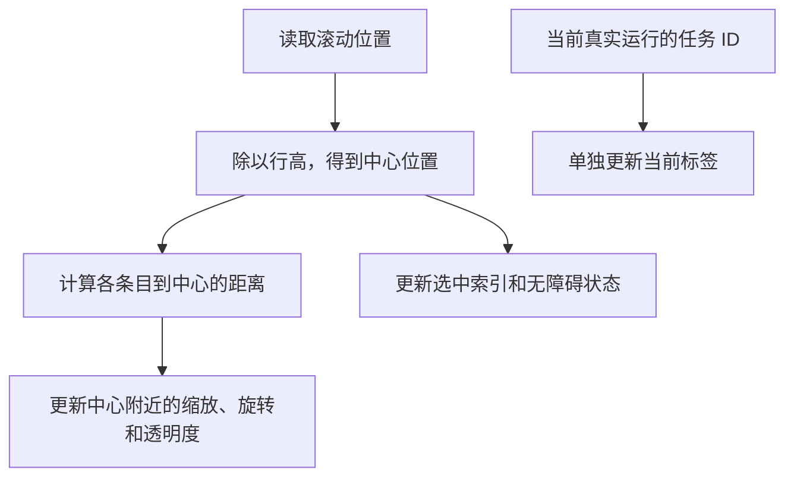

# 滚轮、菜单与窗口

界面层读取当前任务和报告的投影，再把用户的明确操作交给对应执行器。浏览列表、切换栏目和改变实际运行起点分别处理。

## 一、待刷滚轮如何居中

`createCourseWheel()` 采用固定 **76px** 的行高，以滚动距离计算当前居中项：

```text
当前位置 p = scrollTop / 76
选中索引 = round(p)，再限制在 0 到最后一项之间
```

列表上下增加与容器高度相关的边缘空间，使第一项和最后一项也能滚到中心。点击某行或按方向键后，把滚动目标设置为 `索引 × 76`。

### 为什么上下条目会缩小和淡出

每条记录与中心的相对距离为 `d = 条目索引 - p`。当前算法据此设置视觉参数：

| 参数 | 计算规则 |
| --- | --- |
| 透明度 | `max(0.12, 1 - abs(d) × 0.24)` |
| 缩放 | `max(0.76, 1 - abs(d) × 0.075)` |
| X 轴旋转 | `-d × 16°`，限制在 -55° 到 55° |
| 远处模糊 | 距离超过 1.5 行后逐渐增加，最高 1.2px |



“浏览时居中的一项”和“真实正在执行的一项”分别由浏览索引、运行任务 ID 表示。滚动列表主要用于查看任务；实际起点和跳过行为由运行按钮及设置决定。

## 二、滚轮为何一次切一项

鼠标滚轮产生的 `deltaY` 可能很大，也可能在很短时间内连续发出多个事件。当前处理会：

1. 排除 Ctrl 缩放、Shift／横向滚动及无法取消的事件。
2. 阻止本次原生垂直滚动叠加。
3. 只读取方向，切换到相邻一项。
4. 在 **180ms** 时间窗内合并同一短促输入产生的后续事件。

触摸滚动和键盘浏览保留自己的路径。方向键逐项移动，Home／End 到首尾；开启减少动态效果时，居中操作使用对应的简化行为。

### 怎样控制重绘开销

滚动事件通过 `requestAnimationFrame` 合并到绘制周期。每次主要更新中心前后约四项的视觉状态，把离开显示范围的条目设为隐藏状态。

行节点仍按当前清单创建，优化重点是减少连续滚动时的样式重绘。列表数据签名变化时才重建；更新后尽量按条目身份保持浏览位置。

## 三、课程进度条怎么算

从课程卡片的原生文本读取已完成数量 `done` 和总数量 `total`，只有整数且 `0 ≤ done ≤ total`、`total > 0` 时才形成有效进度。

```text
百分比 = done / total × 100%
```

当前课程列表可选资格还会检查是否已结束及是否提供有效正任务总数。原生未提供有效进度的项目按当前展示规则标为“无任务点”并置灰。

进入具体课程后，空目录识别会进一步结合 **加载完成、原生 0/0、暂无章节提示和没有章节项** 等证据，并按课程身份保存状态。展示资格与具体课程的空目录核对属于不同阶段。

## 四、课程菜单如何自动读取

菜单管理只在具体课程中启用，读取已识别的原生菜单结构及入口。每个菜单保留显示名称、原目标和独立隐藏偏好。

点击助手里的菜单名称或图标时，会重新查找并核对原入口，再执行原生导航。隐藏开关独立处理，运行中按操作资格禁用导航。

### 原生图标怎样同步

原页面的图标可能来自：

- `` 图片。
- 基础 SVG 图形。
- CSS 背景图或 mask。
- 精灵图中的一块区域。
- 伪元素或图标字体。

适配器读取图形及必要的计算样式。SVG 只重建支持的基础几何和属性；精灵图会保留原绘制框、背景位置、尺寸和盒模型。

```text
原生图标节点
  → 识别图片／SVG／背景或伪元素
  → 记录原始绘制尺寸和裁切范围
  → 在独立容器内重建
  → 整体缩放到助手图标尺寸
```

先按原尺寸确定裁切区域，再整体缩放，可以保持精灵图的位置关系。菜单加载或状态改变后，图标会随原菜单重新读取。

### 隐藏后如何恢复

隐藏使用专门的管理标记和样式，保留原生菜单节点及处理函数。关闭某个隐藏开关时，撤销相应标记；页面切换或管理器清理时恢复自己接管的项目。

## 五、“默认打开课程”怎样触发

该开关保存在脚本设置中。下次访问个人空间时，初始化流程读取开关，寻找唯一且可靠的原生“课程”菜单并执行一次点击。

识别过程允许菜单延迟加载，同时观察用户是否已经手动切换。当前访问完成一次触发后，不再反复点击；浏览器返回恢复按其恢复标记处理。

开关作用于个人空间的初始导航，个人空间原生侧栏继续保留。

## 六、窗口和透明悬浮 Logo

窗口状态分为打开、最小化和关闭。最小化后显示绿色书本 Logo，点击恢复面板，拖动则更新悬浮位置。

当前 Logo 原图自带 alpha 通道，构建时内嵌到完整脚本。悬浮按钮的点击区域为 **44 × 44px**，背景、边框和阴影透明，图像等比完整显示。

拖动使用指针输入和窗口边界约束。面板移动、缩放、最小化及恢复分别更新显示状态，原执行任务继续由运行器维护。

## 七、不可用控件为何仍能解释原因

禁用状态由当前任务能力和页面状态计算，包含原生 `disabled`、无障碍属性及具体原因。

反馈层在悬停或相应点击路径显示原因，执行入口还会再次检查资格。例如：首页“从当前开始”禁用、运行中不能修改凭据、没有可重试内容时禁用重试。

因此，提示层负责解释，执行层负责最终决定动作是否允许。

## 主要源码位置

`sources/course-run-preview.js`、`sources/course-controls.js`、`sources/platform-menu.js`、`sources/other-features.js`、`sources/assistant-window.js`、`sources/control-feedback.js`、`sources/panel-template.html`。
