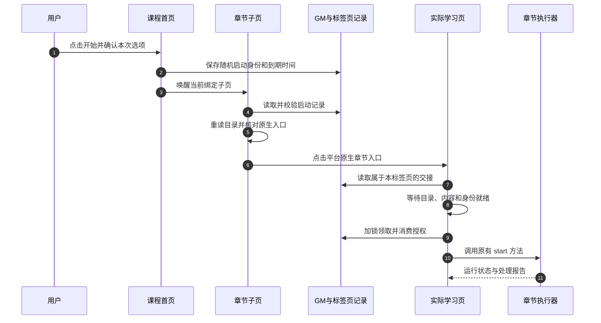
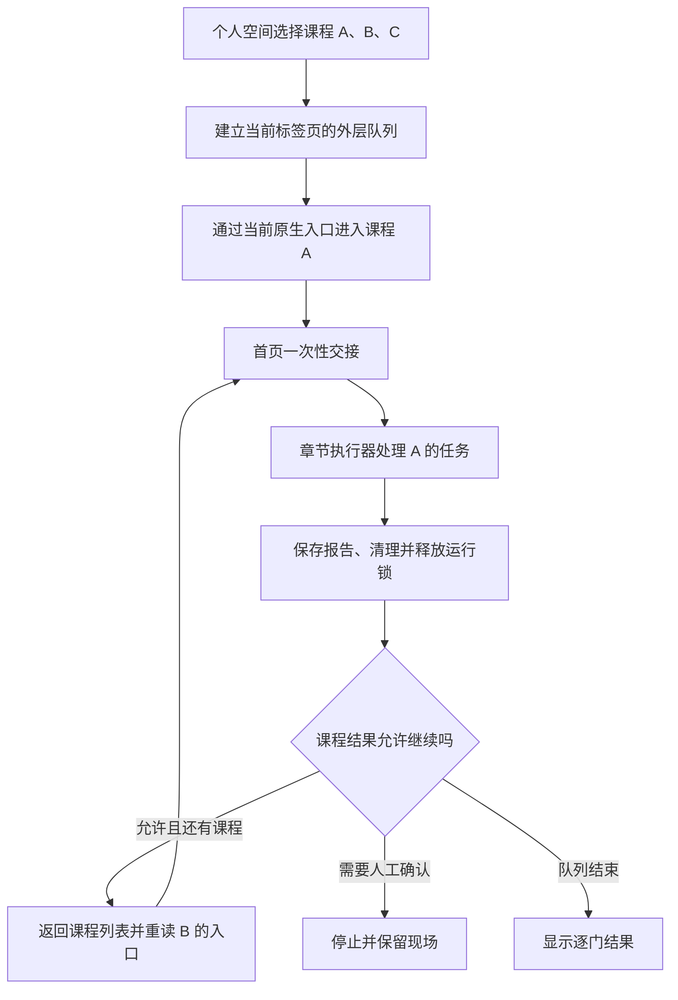
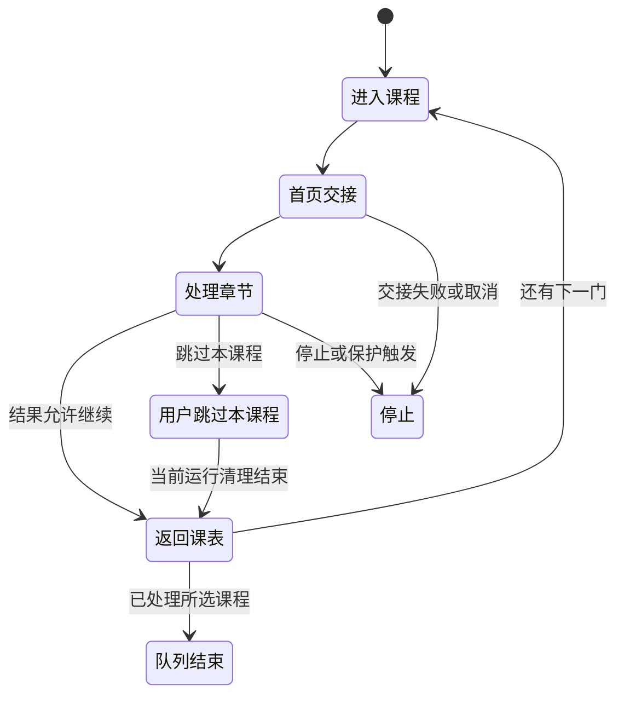

# 跨页交接与课程队列

导航会销毁当前页面的 JavaScript 内存。为继续本次操作，脚本把“可恢复状态”存入 GM 存储和标签页记录，再由目标页校验领取。

## 一、先确定当前是谁、在哪门课程

主要身份由课程、班级和当前学习标识组成，代码中常表示为：

```text
course + classroom + student
```

其中 `student` 是当前页面读到的 `cpi` 等学习身份标识。脚本还会比较顶层地址、iframe 地址及原生隐藏字段；发现冲突时，显示对应原因。

同一个显示名称可能对应不同班级。因此，目录、课程队列和运行记录通过这些字段关联。

## 二、首页怎样选择启动章节

`courseHomeSelection()` 按目录顺序执行：

1. 目录尚未完整就绪：等待加载。
2. 平台明确为空目录：返回无需刷课。
3. 开启“自动跳过已学”：跳过已确认完成或剩余任务为零的章节前缀。
4. 遇到第一个待处理或状态未知的章节：选择它作为原生导航目标。
5. 遍历完目录后，再核对总任务统计是否一致。

例如，目录前四章状态为：

| 章节 | 原生状态 | 选择结果 |
| --- | --- | --- |
| 第 1 章 | 已完成 | 加入可跳过前缀 |
| 第 2 章 | 明确无剩余任务 | 加入可跳过前缀 |
| 第 3 章 | 状态未确认 | 作为导航目标，进入后检查 |
| 第 4 章 | 明确未完成 | 等待处理完前面的范围 |

关闭“自动跳过已学”时，从原目录起点处理。首页保持“从当前开始”禁用，实际学习页继续使用自己的当前章节／栏目规则。

## 三、为什么需要子页自己读取目录

顶层页面与 iframe 即使看起来属于同一平台，也可能受来源或 `document.domain` 隔离影响，父页读取内部 DOM 会触发访问异常。

首页目录适配采用两条路径：

- 可以读取时，由适配器直接读取当前 iframe 的实际文档。
- 处于隔离状态时，由章节 iframe 中的脚本读取自己的 DOM，向已绑定父页同步规范化目录。

通信组合了 `postMessage` 唤醒和私有 GM 记录。消息要与当前 iframe、来源、标签页及文档绑定对应；真正的目录、命令和结果还要经记录检查。

当 iframe 被替换、地址改变或课程身份变化时，原绑定失效，之后重新建立。

## 四、原生导航具体做什么

首页适配识别当前平台提供的章节入口，如已支持的 `toOld(...)` 处理函数，严格解析参数并核对章节、课程和班级，再点击原节点。

目录内手动点击同样走原生导航，只负责进入章节。自动启动还需要单独的本次启动记录。

## 五、一次性启动如何交接

启动记录的主要内容如下：

| 字段类别 | 内容 |
| --- | --- |
| 请求身份 | 随机 UUID、创建时间、到期时间 |
| 课程身份 | 课程、班级、当前学习标识 |
| 页面归属 | 源标签页、目标标签页、预期来源 |
| 本轮设置 | 冻结后的学习选项和提交授权 |
| 模型签名 | 当前模型配置及凭据的比较指纹 |
| 章节目标 | 原生章节 ID、可跳过前缀 |
| 状态 | 准备、导航、等待、领取、启动、失败或取消 |

原始 API Key 留在凭据设置中，启动记录携带比较签名。



### 目标页会检查什么

目标学习页每 **500ms** 检查一次就绪条件。整个首页交接有效期为创建后的 **120 秒**，刷新后继续沿用原期限。

领取前核对：

- 当前确为顶层实际学习页。
- 标签页身份和预期来源一致。
- 课程、班级、学习身份和目标章节一致。
- 模型及凭据签名一致。
- 目录和内容已经就绪。
- 没有验证阻挡，也没有重复运行。
- 所属课程队列仍然有效。

最后使用请求级浏览器锁串行领取，把记录改为 `consumed`，清除待交接身份，并撤销存储记录中的可重复提交权限，然后调用执行器。

### 到达后为何还要核对目录前缀

学习页会比较首页保存的章节前缀和新目录顺序。只有目标位置、章节身份及前缀状态相符，才传入内部参数 `startChapterId`。

出现矛盾时取消该快捷起点，交由原任务定位器重新检查。进入目标章后仍扫描该章全部栏目，避免沿用平台上一次打开的栏目而遗漏内容。

## 六、新标签页怎样绑定

原生入口可能在新标签页打开。当前实现支持两类绑定：

1. **一次性链接标识**：由目标页读取标识，加锁绑定本标签页，处理后清除该标识。
2. **opener 握手**：核对来源窗口、referrer、随机 hello 记录、课程和目标章节，再把该目标标签页固定到本次启动。

这项能力属于首页启动交接。课程列表启动的外层队列采用当前标签页连续运行。

## 七、外层课程队列怎样组织

课程队列记录的是“选了哪些课程、处理到哪一门”；章节执行器记录的是“本门处理到哪一章、哪个栏目和任务”。



开始后课程选择和本轮设置被冻结。每次换课会回到课程列表，重新读取下一门的有效入口及身份，而不是一直使用最初缓存的页面节点。

独立从课程首页或实际学习页开始时，不携带外层队列上下文，结束范围保持在本课程。

## 何时进入下一门课程

`courseQueueOutcome()` 按报告和保护状态分类：

| 当前结果 | 后续行为 |
| --- | --- |
| 报告结束，章节都属于 `already`、`done`、`no-tasks` | 课程归入 `completed`，进入下一门 |
| 报告结束，但留有人工待办等内容 | 课程归入 `pending`，保存待办后进入下一门 |
| 明确顺序解锁边界 | 保存 `waiting-unlock`，进入下一门 |
| 普通超时 | 根据本轮“超时后继续”设置处理 |
| 提交开始但结果未确认，或视频弹题未确认 | 停止整个队列 |
| 原生验证阻挡、连续超时保护触发 | 停止整个队列 |
| 其他导航边界或启动失败 | 停止并显示原因 |

其中 `completed` 是外层对内部报告的归类；`no-tasks` 的来源和平台实际状态仍保留在具体章节记录中。

## 八、怎样避免旧回调误换课

外层队列令牌包含 `id`、`turn` 和 `index`：

- `id` 对应本轮课程队列。
- `turn` 在进入下一门时重新生成。
- `index` 对应当前课程位置。

写入结果或继续导航前，令牌必须仍匹配当前记录。旧课程的晚到回调会与新轮次不符，从而失去继续权限。

章节执行器包装层在运行结束、清理完成并退出课程锁后，才通知外层队列处理结果。

## 九、刷新恢复与重新开始有何区别

章节运行恢复会核对保存记录、当前会话、明确的导航交接标记及心跳时效，再继续原队列。`resumeIfNeeded()` 的当前心跳窗口为 **60 秒**，恢复后提交权限重新按恢复规则处理。

外层课程队列在当前标签页保留队列身份，并检查所处页面是否仍在预期原生路径内。课程运行、启动和返回课表分别拥有不同阶段，任一阶段失效会留下停止原因。



## 主要源码位置

`sources/course-home-launch.js`、`sources/course-list.js`、`sources/course-queue.js`、`sources/course-controls.js`、`sources/course-runner.js`、`course_catalog.js`。
