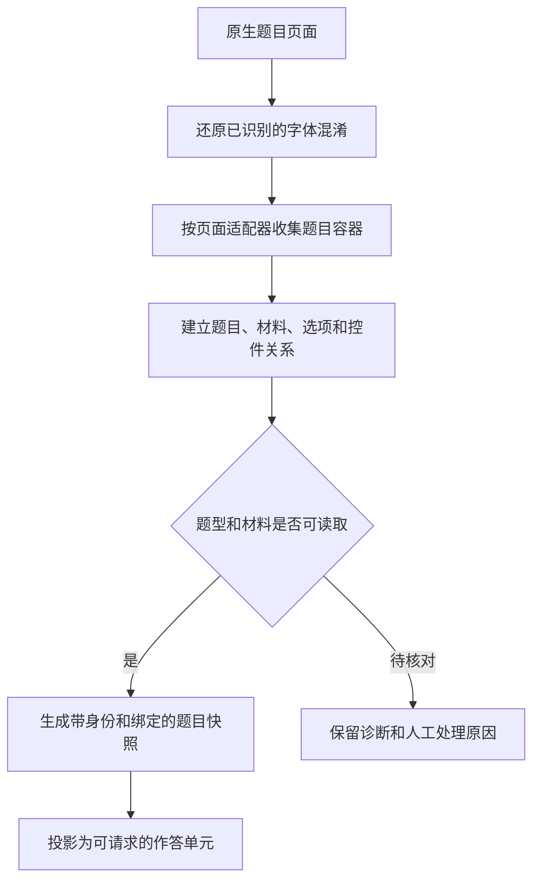
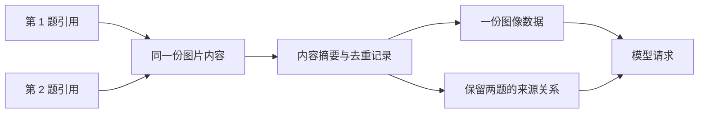
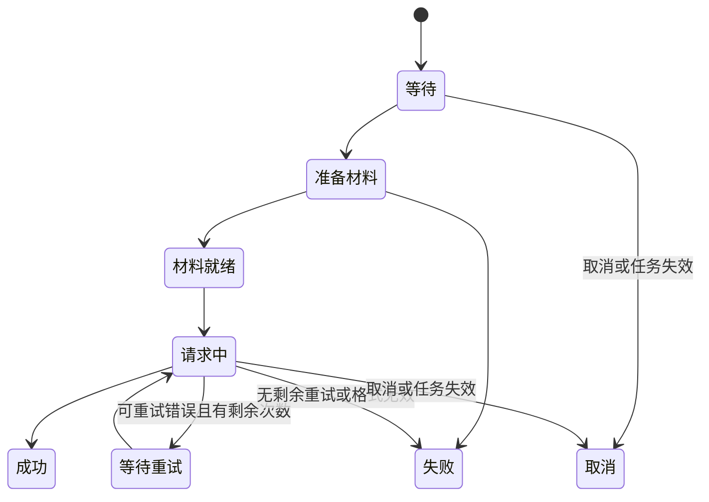
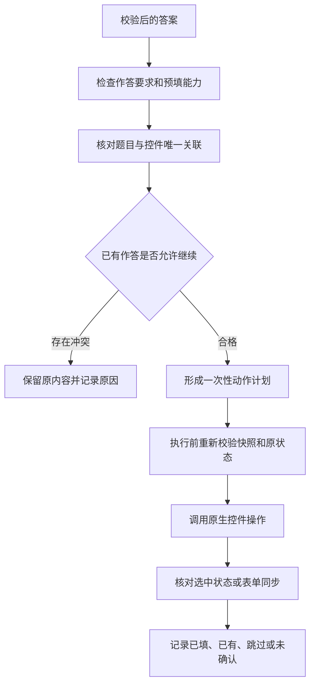

# 题目识别与作答算法

题目处理分成“读懂页面结构”和“推理答案”两部分。脚本使用页面适配规则确定题目及控件关系，模型根据发送的文字、图片和资料生成解答。

## 一、从页面生成题目快照



### 字体混淆怎样还原

部分页面的 DOM 文本使用了自定义字体：字符编码与屏幕上看见的字形不一致。`ensureFontDecoded()` 会寻找 `.font-cxsecret` 文本区域及对应的内嵌字体。

处理步骤如下：

1. 从样式中读取 Base64 字体，解析字体数据。
2. 遍历实现覆盖的汉字编码范围，读取每个编码对应的字形。
3. 将字形路径序列化，计算 MD5，并取末尾片段作为字形映射键。
4. 根据字符映射表得到实际汉字。
5. 先为所有相关文本节点生成替换结果。
6. 全部可处理后，再统一写回文本节点并移除该区域的混淆标记。

字形可表示为：

```text
编码 → 字形编号 → 字形路径 → 路径指纹 → 实际汉字
```

同一份字体的处理结果用 `fontCache` 保存为 Promise。并发调用会共享同一项解析工作；失败项移出缓存，方便之后重新读取。

只替换文本节点可保留原页面的输入框、事件绑定和图片。没有自定义字形的普通中文按原样保留。

### 页面适配器如何识别题目

解析器登记了章节测验、作业及已支持的视频弹题等适配。每个适配器负责：

- 从相应页面结构收集题目容器。
- 读取题型标签、题干、说明、选项和答案控件。
- 排除无关、隐藏或明确属于答案展示的内容。
- 建立原始选项键与原生节点之间的映射。

对于多选题，脚本使用页面提供的选项编码及保存字段；对于单选题，还会检查单选组是否局限于当前题目。

数学内容优先使用可读取的原生公式表达；图片、SVG、Canvas 等视觉内容再进入材料处理流程。

## 二、统一题目图包含什么

当前题目快照的 `schemaVersion` 为 **3**。核心对象包括：

| 对象 | 保存的关系 | 作用 |
| --- | --- | --- |
| `questions` | 题目 ID、类型、题干、选项、说明 | 形成模型输入及结果定位依据 |
| `materials` / `media` | 共用材料、图片位置、选项归属、内容签名 | 保留每份材料的来源 |
| `responseUnits` | 需要生成答案的作答单元 | 对应逐题请求及执行资格 |
| `controls` / `bindings` | 作答单元与原生 DOM 节点的关联 | 执行预填 |
| `relations` | 题目、材料及控件之间的关联 | 表达共享材料等结构 |
| `lifecycle` | 文档、快照及任务身份 | 识别旧页面或旧任务 |

题号用于展示，题目 ID 用于关联。请求返回顺序变化时，结果仍按 ID 找回原题。

### 为什么要检查快照

从读取题目到收到模型回复，页面可能已经切换。`assertQuestionSnapshot()` 会重新检查：

1. 文档的根节点与 body 是否仍是原来的对象。
2. iframe 是否仍连接，内部文档是否已替换。
3. 题干、选项、材料及结构内容签名是否一致。
4. 原控件节点和原生保存字段是否仍对应。
5. 当前任务及取消信号是否有效。

题干变化、控件重建或页面导航会使旧快照失效。重新解析得到的身份相同，才继续后续操作。

## 三、图片怎样读取和去重

每张图片先有一个**来源描述**，记录它属于题干、某个选项还是共享材料。读取后再增加 MIME、尺寸、内容摘要和可发送的数据。

图片处理使用两层复用：

- **读取复用**：相同材料的读取过程共享缓存 Promise，减少重复获取。
- **请求去重**：按实际内容摘要合并图片，同时保留所有题目、材料和选项来源。

例如，两道题引用同一张表格，逻辑上仍有两个引用关系；构造同一请求时，可以只放一份图像数据，并在材料清单中说明它供哪些题使用。



SVG、Canvas 在读取前后会检查内容签名。SVG 先按支持范围处理，再转换为图像材料；无法可靠读取时，该材料会给出具体错误。

当前代码包含的大小保护如下。服务商还可能有更低限制。

| 项目 | 当前限制 |
| --- | --- |
| 单图字节数 | 32 MiB |
| 通用请求体 | 44 MiB |
| 通义千问请求体的附加限制 | 16 MiB |
| 单次请求图像数 | 最多 600 张 |
| 图像单边 | 15 张及以上时 4096 像素，否则 8192 像素 |
| 原生视觉图形的像素保护 | 16 × 1024 × 1024 像素 |

这些是请求前的保护阈值，适用于允许进入相应流程的材料。

## 四、为什么使用逐题请求

`splitQuestionBatches()` 将每个作答请求单元单独组成一批。这样，某题的输出长度、格式错误或重试状态可以独立记录，已成功的结果继续保留。

总体过程为：

```text
冻结题目快照和模型设置
  → 为每题建立 pending 记录
  → 准备该题需要的图片
  → 等待请求并发名额
  → 可选联网检索
  → 调用答案模型
  → 校验并保存本题结果
  → 合并到总列表
```

### 并发和顺序是怎样安排的

题目分析并发可设为 **1–7**，无效值回到 **3**。材料准备使用单独的并发限制；逐题分析接入时可同时准备两份题目记录，每条记录内的图片准备按其调用设置控制。

假设有 5 道题、分析并发为 3，前 3 道获得请求名额。任意一题结束后，下一道就可以补位。结果按题目 ID 合并，因此页面展示顺序与网络返回顺序分离。



### 重试采用什么规则

重试要由调用方开启。当前调度器区分：

- 网络超时、429、502、503、504 等暂时性错误：最多尝试 3 次。
- 部分响应结构或 JSON 格式错误：最多尝试 2 次。
- 凭据、权限、配置变化或页面身份异常：进入相应失败或终止分支。

等待时间包含指数退避和小幅随机抖动：

```text
等待毫秒数 = 2000 × 2^(已经尝试的次数 - 1) × (1 + 0～0.25 的随机值)
```

收到 429 或明确的 `Retry-After` 时，还会更新共享的最早可请求时间。连续暂时性请求失败达到 **5** 次，会暂停后续调度，保留已完成结果。

这组“请求失败暂停”和课程的“连续章节超时保护”是两套独立计数。

## 五、怎样判断模型返回可用

脚本要求模型返回结构化 JSON，主要形式为：

```json
{
  "answers": [
    {"id": "q-1", "answer": ["B"], "reason": "解析内容"}
  ]
}
```

接收时依次校验 HTTP 状态、接口字段、停止原因、JSON 结构、题目 ID、答案类型及选项键。

| 题型 | 答案约束 |
| --- | --- |
| 单选、判断 | 恰好一个有效选项键 |
| 多选 | 非空、无重复、全部可映射的选项键 |
| 填空、文字解答 | 当前请求结构要求的一条非空文字答案 |
| 未识别或材料不完整 | 保留对应原因，进入人工核对或失败分支 |

逐题请求还要求返回恰好对应这一题的 ID。输出达到长度上限时，保留“未完成”状态，后续可针对该题处理。

## 六、答案如何进入原生作答区

预填分两步：`planQuestionActions()` 先形成动作计划，`executeQuestionActions()` 再校验并执行。



对于选择题，动作会定位到原页面的选项点击入口或原生选择控件，并检查实际选中状态及保存编码。多选题会核对整组选项关系。

对于文本框，要求当前可写槽位和答案能够可靠对应。对于已适配的 UEditor，还会检查实例、编辑区、隐藏 textarea 和表单关系，写入后核对同步；需要人工保存时在结果中说明。

计划只能执行一次。执行期间用户的真实输入、点击或控件替换会触发重新检查，冲突时停止自动写入。

### 能生成解答与能自动预填分别判断

一道要求手写、绘图或上传附件的题，仍可生成文字解法和步骤。预填策略随后检查提交形式，保留相应人工处理原因。

自动学习中的章节测验还要检查全部作答单元是否合格，并使用[本次提交授权](data-safety.md#自动提交授权怎样约束操作)。

## 主要源码位置

`sources/font-decoder.js`、`sources/question-parser.js`、`sources/question-context.js`、`sources/question-media.js`、`sources/question-workflow.js`、`sources/analysis-scheduler.js`、`sources/analysis-session.js`、`sources/question-actions.js`。
