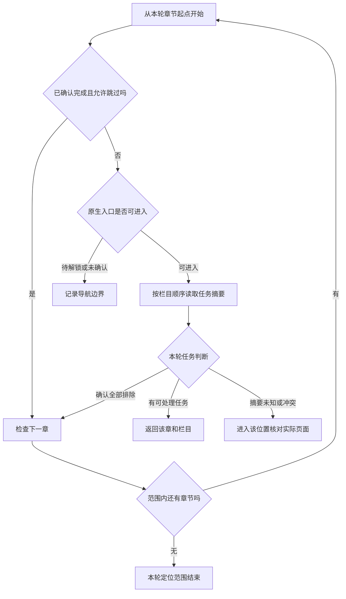
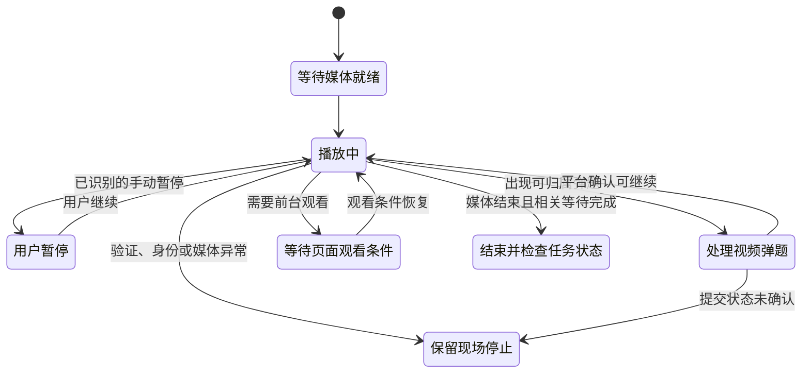
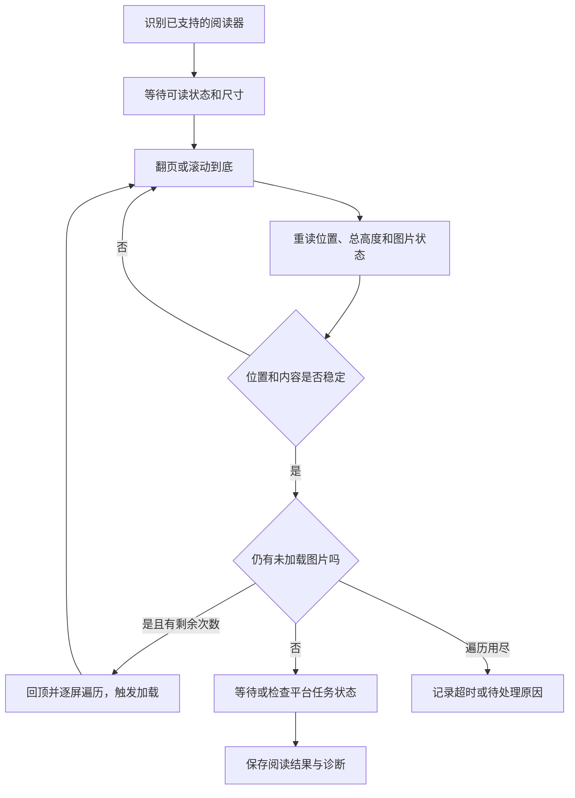

# 任务定位与学习执行

实际学习由 `createCourseRunner()` 创建的执行器完成。课程首页和课程队列最终都会调用它，视频、资料、测验及后续章节沿用同一条处理链。

## 一、运行范围先固定下来

开始时读取课程、班级和当前学习身份，并从目录建立本轮队列。根据入口和选项确定起点：

| 情况 | 起点规则 |
| --- | --- |
| 普通单课程开始 | 按原目录建立章节范围，再按设置定位 |
| 实际学习页“从当前开始” | 要求唯一当前章节，并记录当前栏目身份及索引 |
| 首页携带可靠的目标章节 | 复核目录前缀后，从目标章节开始；章内从全部栏目检查 |
| 已有运行的导航恢复 | 继续保存的队列、章节索引和栏目进度 |
| 重试未完成 | 根据原报告筛选可重试章节，再核对当前目录 |

随后冻结本轮配置和模型签名，记录运行 ID、报告、取消信号和预期页面状态。运行中的检查围绕这些固定身份展开。

## 二、怎样定位未完成任务

### 目录先提供粗粒度信息

目录条目包含章节 ID、顺序、完成状态、剩余任务数和导航资格。已确认完成的章节可按设置跳过；未知状态保留为需要进一步检查的内容。

真正任务还在章节的不同栏目中。例如同一章可能有视频、资料、章节测验，也可能包含无需本轮处理的内容。

### 任务摘要减少无效切页

`courseTaskProbe()` 会读取已支持页面的栏目和任务摘要。实际学习页中的摘要读取使用已核对身份的同源页面地址，包括原生学习页片段和 cards 内容。

读取遵循以下顺序：

1. 核对实际学习页、内容 iframe、课程及章节归属。
2. 优先利用当前已加载的栏目和内容。
3. 必要时获取同源只读 HTML，并在分离的结构中解析。
4. 只按已适配的字段识别栏目、任务类型、是否必修及完成状态。
5. 结构不明或页面状态冲突时，返回“需要检查实际页面”。

首页阶段负责点击原生入口。上述摘要请求发生在实际学习页的任务定位阶段，用于减少不必要的章节和栏目跳转。

### 有界预读，按目录顺序决策

当前定位器可以预读前方最多 **4 个章节**的候选信息，各章节按有界窗口安排栏目读取；底层摘要网络读取最多 **4 个**同时执行。

调度优先级采用“章节索引、栏目索引”的顺序比较。读取可以提前完成，最终目标仍按目录顺序确定。



例如，第 5 章的摘要先返回，也要等前面的章节完成顺序判断。遇到第 3 章未知时，会把第 3 章交给实际页面检查。

### 什么任务会被排除

`courseTaskEligibility()` 使用明确规则：

| 条件 | 定位结果 |
| --- | --- |
| 任务明确标为非必做 | 排除 |
| 开启跳过已学或处于重试，且任务已完成 | 排除 |
| 章节测验且本轮未授权自动提交 | 排除本轮自动测验流程，保留人工待办 |
| 已识别的知识图谱任务 | 排除本轮自动处理 |
| 视频／资料／测验，必做和完成状态均已识别 | 交给对应执行流程 |
| 类型、必做或完成状态不明 | 定位到实际页面进一步核对 |

目录的剩余数量还会与摘要中可能未完成的任务数比较。存在矛盾时，当前摘要不作为继续跳过的依据。

### 缓存怎样避免读旧状态

摘要缓存保存规范化结果，时效为 **60 秒**，并按课程身份和章节状态管理。相同的在途读取可以共享。

章节完成状态、剩余数量、导航证据或栏目结构改变后，相关缓存会失效。真正进入页面时还会重新读取可见任务，检查它与摘要是否冲突。

## 三、章节执行循环

每一章的大致过程为：

```text
确认原目录条目还存在
  → 检查完成状态与导航资格
  → 定位第一个需检查的栏目
  → 经原生入口进入或切换
  → 等待实际内容和 iframe 就绪
  → 逐项处理本栏任务
  → 检查后续栏目及章节状态
  → 保存报告，进入下一章
```

章节内有独立取消信号。“跳过本章节”会取消这一章的等待和动作，并在报告中标为用户跳过；整轮停止使用更上层的取消信号。

## 四、视频如何播放和监控

### 启动与当前播放器绑定

脚本确认当前任务归属后，优先使用可识别的原生播放按钮，否则调用视频的播放方法。播放请求会监听 `playing`、`pause`、`ended`、`error` 等事件，并与本次取消信号绑定。

页面上同时出现视频任务、弹题和验证提示时，处理优先级由当前状态决定。手动暂停、需要前台观看、视频弹题及人工验证各有独立等待或停止分支。

### 播放进度怎样判断

播放器监控同时读取：

- 媒体时间 `currentTime` 和总时长。
- 墙钟经过时间。
- 当前及上一采样点的播放倍速。
- `played` 已播放区间、媒体就绪及 seeking 状态。

时间前进的允许范围可概括为：

```text
允许前进秒数 = 墙钟经过秒数 × 两次采样倍速的较大值 + 2 秒容差
```

`courseVideoPositionDecision()` 据此区分连续播放、向后回退、已播放区间内的定位、存在未覆盖区间的前跳和暂未就绪等状态。

这些分类供执行器决定重新锚定、等待、回看或报出异常。任务完成仍要结合后续平台标记检查。

### 意外暂停与手动暂停

连续播放和后台播放保护只在当前视频上下文、运行身份和页面条件满足时生效。恢复请求有次数限制，观察到足够的有效进展后再更新恢复计数。

用户通过已识别的播放控件或快捷键暂停时，进入人工暂停分支。点击“继续”后再请求播放。



### 倍速和视频间隔

倍速读取播放器提供的原生档位，选择最高且不超过 **2 倍**的可用速度。视频信息识别开启时保持原速，并对倍速设置和确认分别安排等待。

视频间隔支持固定值和随机区间。等待截止时间保存在运行记录中，导航恢复会继续沿用相应记录。

## 五、资料和 PPT 怎样阅读

### 先识别阅读器类型

适配器会区分翻页阅读器、同文档滚动阅读器及已确认的跨域阅读器。跨域场景由阅读器内的脚本执行限定操作，返回滚动状态。

阅读请求主要包括 `read`、`step`、`bottom`、`top`、`scan`，分别用于读状态、翻页、到底、回顶和遍历。

### 滚动到底要结合加载状态

滚动阅读检查 `top`、可视高度 `height`、总高度 `total`、图片数量及未加载图片数量。底部距离按下式计算：

```text
底部距离 = abs(max(0, total - height) - top)
```

当前实现以 **1px** 以内作为到底位置判断，同时检查加载状态和尺寸变化。



代码要求稳定底部样本达到 **3 次**，并满足至少 **1 秒**的稳定时长。图片仍未加载时，最多执行 **2 轮**回顶和逐屏遍历。

总阅读期限、图片加载和平台确认等待分别受限。报告保留位置、距底部距离、图片加载数量、到底校正及遍历轮数，便于识别卡在哪一阶段。

## 六、章节测验怎样处理

1. 检查平台是否已完成该测验。
2. 检查本轮自动提交授权；关闭时记录人工待办。
3. 解密字体并提取题目快照。
4. 调用逐题分析链，保留成功答案和失败原因。
5. 通过统一预填计划执行合格答案。
6. 核对所有作答单元、原生控件状态及人工保存要求。
7. 识别唯一的提交入口，记录“已开始提交”，再点击原生按钮。
8. 等待对应测验的原生完成状态，必要时处理唯一的确认入口。

提交后会核对文档、iframe、原测验 ID 和结果页面。提交结果未明确时，保留该状态交由人工核对。

视频弹题使用独立适配器确认它属于当前播放器，再复用题目分析和填写逻辑。平台明确判错时可利用记录的反馈进入有限后续处理；用户介入、要求回看或反馈不明分别进入相应分支。

## 七、完成、排除和待办怎样记录

| 章节报告状态 | 解释 |
| --- | --- |
| `already` | 目录或任务证据表明原本已完成 |
| `done` | 本章处理流程完成，并经过该流程的状态检查 |
| `no-tasks` | 摘要中没有本轮需执行任务；具体原因保留在报告中 |
| `manual-pending` | 留有人工需要处理的内容 |
| `timed-out` | 在相应等待阶段达到期限 |
| `skipped` | 用户主动跳过 |
| `waiting-unlock` | 遇到明确顺序解锁边界 |
| `navigation-unknown` | 原生导航资格或入口尚未确认 |

`no-tasks` 也可能由本轮设置排除任务产生，阅读报告时应同时看原因与平台目录。外层如何归类这些状态，见[课程队列结果判断](navigation-queue.md#何时进入下一门课程)。

## 八、超时、休息与顺序解锁

顺序解锁会检查前置章节，确认后等待原生入口更新，当前最长等待 **15 秒**。待解锁状态单独记入报告。

学习休息按本轮累计活动时长计算，在满足条件的章节边界休息。默认参数为连续学习 50 分钟、休息 10 分钟，是否启用由开关决定；课程队列传递本轮累计值。

连续章节超时保护默认关闭。开启后，当前阈值为 **3** 个连续超时；成功完成或已完成章节会清零，主动跳过、人工待办等按各自报告规则保留。

## 当前关键等待参数

| 参数 | 当前值 | 作用 |
| --- | --- | --- |
| `pollMs` | 500ms | 常规状态轮询 |
| `loadMs` | 30 秒 | 页面或阅读状态加载等待 |
| `videoLoadMs` | 60 秒 | 视频加载及播放请求等待 |
| `completionMs` | 30 秒 | 相应任务或章节完成确认 |
| `stallMs` | 5 分钟 | 视频长时间无有效进展检测 |
| `documentMs` | 5 分钟 | 资料阅读期限 |
| `submitMs` | 30 秒 | 章节测验提交状态等待 |

实际分支还会区分人工暂停、弹题、前台观看要求和取消状态。表中参数用于理解阶段性等待。

## 主要源码位置

`course_catalog.js`、`sources/course-page-adapter.js`、`sources/course-runner.js`、`sources/course-document-bridge.js`、`sources/course-video-quiz.js`、`sources/background-playback.js`。
